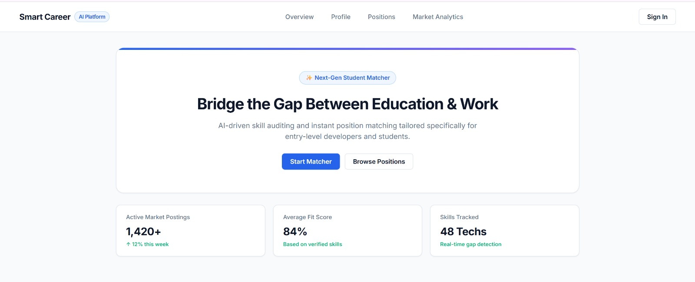
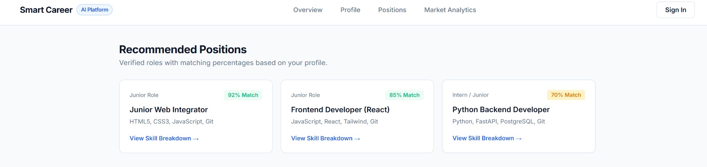
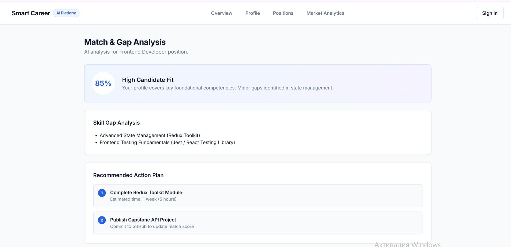

# Next-Step
# 🚀 Next Step — AI-Driven Career Guidance Platform

> **Next-Step** is a lightweight web platform designed to help students, high school seniors, and junior developers find entry-level job opportunities matching their skill sets while offering personalized AI recommendations and roadmaps.

---

## 📌 Key Features

* **Authentication & Profile Setup:** Simple sign-in interface supporting standard login and Google OAuth integration.
* **Smart Skill Analysis:** Fast, non-intrusive data collection via GitHub profile links, resume upload, and interactive skill tag selection.
* **Match Score & Skill Gap Analysis:** Instant visual percentage breakdown of candidate fit for specific job roles along with missing technology alerts.
* **Market Analytics:** Real-time demand tracking of modern technologies and programming languages to prevent redundant learning.
* **Actionable Learning Roadmap:** Step-by-step educational guidance and project ideas to bridge skill gaps.

---

## 🛠 Tech Stack

| Category | Used Stack |
| :--- | :--- |
| **Languages** | HTML5, CSS3, JavaScript (ES6+) |
| **Design System** | Inter Font, Notion/Linear Minimalist SaaS Palette |
| **UI/UX Architecture** | Responsive Grid Layout, Single-Page Architecture |
| **Version Control** | Git, GitHub |

---

## ⚙️ Local Setup

To run this repository locally:

```bash
# Clone the repository
git clone [https://github.com/aanamitbek-arch/Next-Step.git](https://github.com/aanamitbek-arch/Next-Step.git)

# Navigate into the directory
cd Next-Step

# Open index.html in your browser or run via VS Code Live Server
## 📸 Interface Screenshots

| Overview (Hero Section) | Candidate Profile |
| :---: | :---: |
|  |  |

| Position Matching & Analysis |
| :---: |
|  |